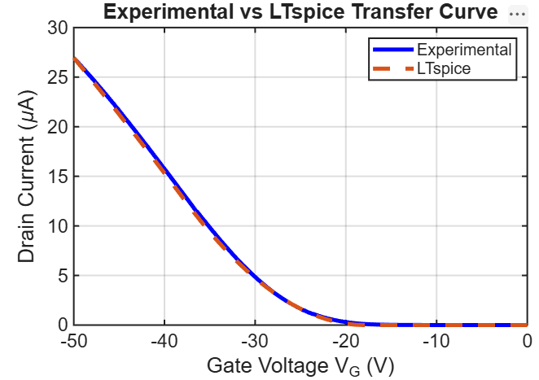
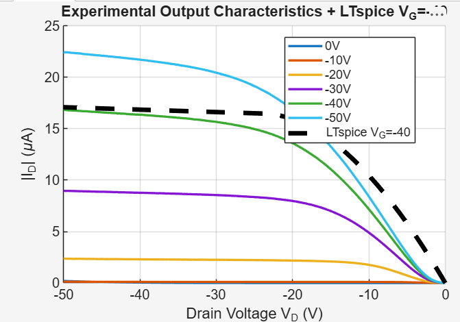
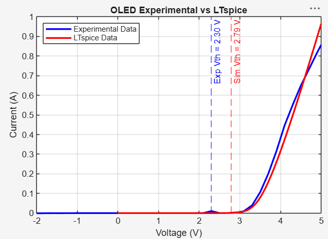
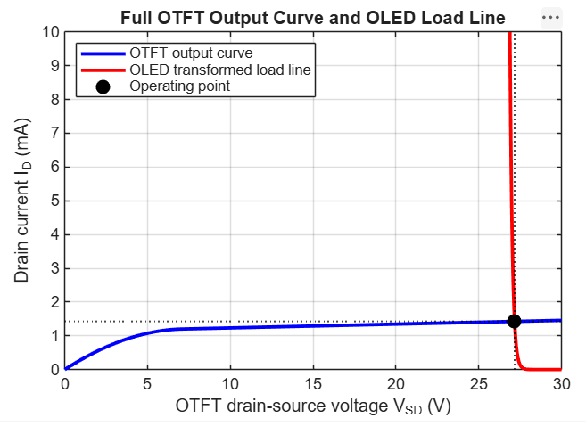
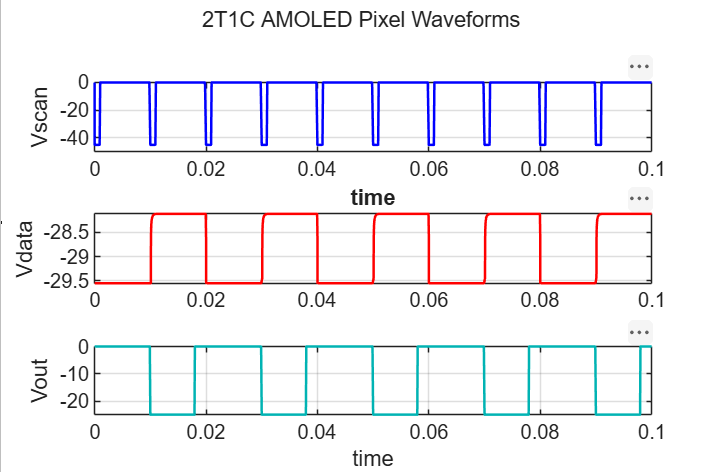
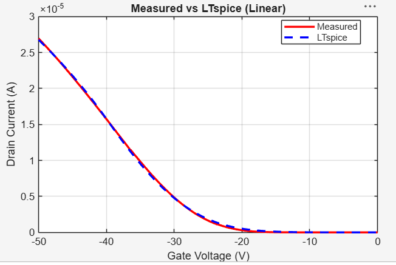

# OTFT-Based 2T1C AMOLED Pixel Circuit: Modeling and Simulation

Simulation project from a research internship at IIT Madras
(April–June 2026).

## Overview
Organic thin-film transistors (OTFTs) are used to drive pixels in flexible
AMOLED displays. This project extracts parameters from measured OTFT data,
builds compact models in LTspice, and uses them to simulate a 2T1C pixel circuit.

## What I did
- Extracted OTFT parameters (threshold voltage, KP, mobility, ION/IOFF, subthreshold swing) from measured data
- Built a Level-1 LTspice model and improved it with a behavioral current source (Bsub)
- Designed OTFT inverters and 3- and 5-stage ring oscillators
- Modelled the OLED from its measured I-V data
- Did load-line analysis to find the OTFT–OLED operating point
- Simulated 2T1C pixel circuits, including gate-source and gate-drain capacitances
- Built BSIM3 compact models (AI-assisted) and compared them with measurements

## Tools
LTspice, MATLAB

## Results

**Level-1 model vs experiment (transfer curve)**

**Level-1 model vs experiment (output curves)**

**OLED model vs experiment**

**OTFT–OLED load line and operating point**

**2T1C pixel circuit waveforms**

**BSIM3 model vs experiment (transfer curve)**

## Circuit files
| File | Description |
|---|---|
| otft_level1_transfer.asc | Level-1 OTFT model |
| otft_bsim3_transfer.asc | BSIM3 OTFT model |
| inverter_resistor_load.asc | Resistor-load inverter |
| ring_osc_3stage.asc / ring_osc_5stage.asc | Ring oscillators |
| oled_model.asc | OLED model |
| pixel_2t1c_initial.asc | Initial 2T1C pixel circuit |
| pixel_2t1c_modified.asc | Modified 2T1C pixel circuit |

## Note
Raw experimental data belongs to IIT Madras and is not included.
